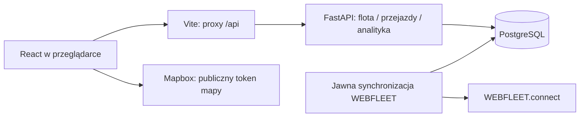

# Architektura Fleet-Flow

Status: fundament do rozwoju MVP. Ustalenia na 7 października 2026.
Temat i zakres produktu pozostają opisane w głównym `README.md`.

## Podział projektu

```text
fleet-flow/
├── frontend/                 React + TypeScript + Vite
│   └── src/
│       ├── app/              router, layout, wspólni providerzy
│       ├── features/         fleet, trips, analytics
│       └── shared/           komponenty, klient API, typy, style
├── backend/                  FastAPI + SQLAlchemy + Alembic
│   ├── app/
│   │   ├── core/             konfiguracja i wspólne reguły
│   │   ├── db/               sesja, modele bazowe, dane demo
│   │   ├── modules/          fleet, trips, analytics
│   │   └── integrations/    adapter WEBFLEET
│   ├── migrations/           wersjonowane migracje PostgreSQL
│   └── tests/                API, reguły produktu, integracja HTTP
├── contracts/                OpenAPI wygenerowane z backendu
├── docs/                     uruchomienie, współpraca, mapa zadań
├── scripts/                  lokalny setup i automatyzacja GitHub
├── .github/                  CI, automatyczny PR, przegląd AI
├── infra/azure/              istniejący VPS i jego harmonogramy
└── compose.yaml              lokalne db + api + web
```

Jedno repozytorium ułatwia wspólną zmianę API i interfejsu w jednym PR.
Backend jest jedną aplikacją z modułami odpowiadającymi trzem funkcjom produktu.
Zespół utrzymuje jeden proces API i jedną bazę danych; podział na mikroserwisy
nie jest potrzebny do tego MVP i do VPS z 4 GiB RAM.

## Kierunek zależności

Przeglądarka wywołuje wyłącznie API Fleet-Flow. React nie zna loginu, hasła ani
klucza WEBFLEET. Backend przechowuje lokalne dane i korzysta z adaptera dostawcy.
Router HTTP waliduje wejście; logika modułu odpowiada za reguły produktu;
warstwa bazy odpowiada za odczyt i zapis. Nie tworzymy osobnej abstrakcji
dla każdego pojedynczego zapytania, jeżeli nie ma z tego praktycznej korzyści.



Na lokalnym serwerze Vite proxy zachowuje jeden adres dla przeglądarki i nie
wymaga wpisywania adresu VPS w kodzie. To konfiguracja deweloperska.
Późniejsze wdrożenie aplikacji będzie miało zbudowany frontend, reverse proxy,
HTTPS i uwierzytelnianie. Istniejący VPS nadal udostępnia tylko SSH; ta zmiana
nie publikuje aplikacji ani bazy w Internecie.

## API i dane

Źródłem definicji API są modele Pydantic i trasy FastAPI. `contracts/openapi.json`
oraz typy TypeScript są generowane. Zmiana kontraktu obejmuje backend, regenerację
typów i dostosowanie frontendu w jednym PR. CI sprawdza zgodność tych plików.

API ma prefiks `/api/v1`, listy mają limit i offset, brak zasobu zwraca 404,
a nie pusty obiekt. Czas przesyłamy w ISO 8601 z UTC; interfejs pokazuje czas
polski. Kilometry i km/h są nazwane w polach, zamiast ukrywać jednostkę.
Brak odczytu oznacza `null` lub status `unknown`, a nie wymyślone zero.

Tryb `demo` pozwala rozwijać i testować aplikację bez dostępu do danych klientów.
Dane demonstracyjne dodaje się jawnie poleceniem seed. Tryb `webfleet` nie może
zwracać danych demo ani przełączać się na demo po błędzie integracji.
Początkowy importer synchronizuje pojazdy; import historii tras i szersze reguły
alertów pozostają zadaniami MVP. Lokalny cel i opis przejazdu są zapisywane
w naszej bazie. Nie wysyłamy ich automatycznie do dostawcy.

## Wydajność i rozwój

- Frontend ładuje strony funkcji na żądanie; Mapbox ładuje się dopiero dla mapy
  i po skonfigurowaniu tokenu. Zapytania mają cache i wspólne stany błędu.
- Lista pojazdów filtruje i ogranicza wyniki na serwerze. Przy większych flotach
  dodajemy paginację w UI, zamiast pobierać pełną historię do przeglądarki.
- Synchronizacja dostawcy jest oddzielona od renderowania strony. Odświeżenie
  przeglądarki nie generuje serii wywołań płatnego lub limitowanego API.
- Indeksy dodajemy tam, gdzie wynikają z rzeczywistych zapytań: pojazd i czas
  przejazdu. Nowe indeksy i tabele wprowadzamy przez migracje.
- Dopiero pomiary uzasadnią dodatkowy cache, kolejkę, worker lub osobną usługę.

## Granice obecnego fundamentu

Nie ma jeszcze logowania użytkowników aplikacji, pełnego importu historii
WEBFLEET, raportu podatkowego ani powiadomień zewnętrznych. Serwisy Compose
są związane z `127.0.0.1`, a API zapisu służy obecnie do lokalnego rozwoju.
Przed publikacją danych prawdziwej floty potrzebne będą autoryzacja, zakresy
dostępu, retencja danych i testy integracji z rzeczywistym kontem.

[Podział aplikacji FastAPI](https://fastapi.tiangolo.com/tutorial/bigger-applications/),
[Vite](https://vite.dev/guide/),
[wersja dokumentacji WEBFLEET wykorzystana przy adapterze](https://media.webfleet.com/fl_attachment/media/doc/documentations/webfleet.connect-doc-1.58.0).
