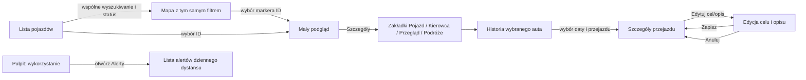

# SCRUM-35 — szkice widoków i przepływy

| Pole | Wartość |
| --- | --- |
| Właściciel | Jakub Nazarewicz |
| Akceptacja produktu | Jakub Czaja (PO), do potwierdzenia |
| Konsultacja QA | Marcel Głowacki, do zapisania w zgłoszeniu |
| Status | Materiał przygotowawczy; bez deklaracji terminu i Story Points |
| Zakres | Dokumentacja i szkice; bez komponentów React i gotowej strony |

## Punkt wyjścia

Szkice zachowują układ i język istniejącego UI z SCRUM-38/20/21/45/46 oraz
częściowego SCRUM-25. Szczegóły wizualne podlegają
[systemowi wyglądu](DESIGN_SYSTEM.md), a klikalny przepływ Sprintu 1 pozostaje
w [prototypie](PROTOTYPE.md). To rozszerzenie dokumentacji, nie nowy projekt
wyglądu ani odbiór implementacji.

Nawigacja pozostaje zgodna z aplikacją: **Pulpit, Mapa, Pojazdy, Serwis,
Ewidencja przebiegu, Kierowcy, Karty paliwowe, Alerty, Ustawienia**. Ustawienia
są osobną pozycją. Mapa nie grupuje markerów; zdjęcia pozostają lokalne,
a kierowcy są wprowadzani ręcznie.

| Story | Zakres szkicu | Granica odpowiedzialności |
| --- | --- | --- |
| [SCRUM-5](https://fleet-flow.atlassian.net/browse/SCRUM-5) | Lista, mapa, filtry i wybór pojazdu | Lista i mapa używają tego samego filtra i tożsamości pojazdu. |
| [SCRUM-6](https://fleet-flow.atlassian.net/browse/SCRUM-6) | Historia przejazdów wybranego pojazdu | Odczyt historii wymaga danych z SCRUM-24; brak trasy nie jest pustą flotą. |
| [SCRUM-7](https://fleet-flow.atlassian.net/browse/SCRUM-7) | Reguła dziennego dystansu i lista alertów | Analityka porównawcza należy do SCRUM-61, nie do alertów. |
| [SCRUM-62](https://fleet-flow.atlassian.net/browse/SCRUM-62) | Ewidencja, cel/opis i podstawowe sumy | Przepływ edycji celu pokazano obok historii; zapis realizują SCRUM-26/27. |

## Szkice widoków

### Lista i mapa floty

```text
┌ Fleet Flow ─ Pulpit ─ Mapa ─ Pojazdy ─ ... ─ Alerty ─ Ustawienia ─────┐
│ [Szukaj nazwy/rejestracji____________] [Status: Wszystkie ▼] [Wyczyść] │
├───────────────────────┬───────────────────────────────────────────────┤
│ LISTA (4 kolumny)     │ MAPA (8 kolumn)                                │
│ FF001 · XY 12345      │  [osobny marker: zdjęcie/auto, status]         │
│ W ruchu · 48 km/h     │  [marker bez klastra; wybór konkretnego ID]    │
│ GPS · przebieg · czas │                                               │
│ FF002 · XY 54321      │                       [Cała flota] [zoom]      │
│ ...                   │                                               │
└───────────────────────┴───────────────────────────────────────────────┘
```

Na szerokim ekranie lista zajmuje boczny panel, mapa główną część widoku;
na wąskim lista przechodzi pod mapę zgodnie z obecnym układem. Wiersz
identyfikuje auto nazwą i rejestracją/numerem. Pokazuje dostępne GPS, status,
prędkość w km/h, przebieg w km i czas pomiaru. Brak wartości ma etykietę
„Brak danych” lub „Brak GPS”, nigdy wartość zero. Pojazd bez GPS zostaje
na liście, ale nie otrzymuje markera.

Wyszukiwanie i filtr statusu są wspólne dla listy i mapy. Kliknięcie wiersza
lub markera wybiera ten sam identyfikator; nakładające się markery nadal
pozwalają wskazać konkretny pojazd. Zaznaczenie nie zmienia filtrów.

### Szczegóły i historia

```text
Mapa: kliknięty marker
┌ FF001 · XY 12345 · W ruchu ─────────┐
│ zdjęcie/ikona · lokalizacja · pomiar │
│                         [Szczegóły] │
└─────────────────────────────────────┘
                    │
                    ▼
┌ Szczegóły pojazdu: FF001 ─────────────────────────────────┐
│ [Pojazd] [Kierowca] [Przegląd] [Podróże]                 │
│                                                           │
│ Podróże: [dzień / zakres] [filtry uzgodnione dla historii]│
│ Czas | Trasa | Dystans | Cel | Opis                 [Edytuj]│
└───────────────────────────────────────────────────────────┘
```

Wybór pojazdu z listy albo mapy otwiera mały podgląd; dopiero przycisk
**Szczegóły** otwiera panel z zakładkami **Pojazd/Kierowca/Przegląd/Podróże**.
Wybrany pojazd pozostaje ten sam przy przejściu między zakładkami. Data lub
zakres zawęża historię tego pojazdu, nie listę floty.

```text
Przejazd → [Edytuj cel i opis]
┌ Cel przejazdu ______________________________┐
│ Opis _______________________________________│
│                                      [Anuluj] [Zapisz] │
└─────────────────────────────────────────────┘
```

Edycja dotyczy ręcznych pól celu/opisu, nie pomiarów źródłowych trasy.
**Zapisz** utrwala wartości i wraca do przejazdu z widocznym celem; **Anuluj**
odrzuca szkic. Błąd zapisu zachowuje wpisany tekst do ponowienia. Brak
uprawnienia nie udostępnia edycji. Szczegóły pól, wymagane wartości i sumy
okresu należy uzgodnić w SCRUM-62; szkic nie przypisuje ich do SCRUM-6.

### Analityka i alerty

```text
Pulpit
┌ Wykorzystanie floty ─────────────── okres: [do uzgodnienia] ─┐
│ Pojazd | dystans | przejazdy | pokrycie danych              │
│ ...                                                        │
└────────────────────────────────────────────────────────────┘

Alerty
┌ Reguła dziennego dystansu ─────────────── [Dodaj regułę*] ──┐
│ Pojazd | dzień | dystans km | próg km | stan                │
│ ...                                                        │
└────────────────────────────────────────────────────────────┘
* Dostępność i uprawnienia do edycji reguł potwierdza PO.
```

Porównanie wykorzystania jest proponowane jako moduł Pulpitu SCRUM-61.
Alerty dziennego dystansu pozostają osobnym widokiem SCRUM-7. Nie należy
wnioskować o wykorzystaniu z niepełnych pomiarów ani pokazywać braku pokrycia
jako zera. Zakres okresu, agregaty, kolejność i znaczenie stanu alertu są
decyzjami do potwierdzenia przez PO; szkic nie ustala progów ani danych demo.

## Przepływy



1. Wyszukaj pojazd nazwą lub rejestracją i opcjonalnie zawęź status. Lista
   oraz mapa aktualizują się razem; wyczyszczenie filtrów przywraca flotę.
2. Wybierz pojazd w dowolnym miejscu. Mały podgląd pokazuje wybrany identyfikator;
   **Szczegóły** przechodzi do tego samego auta i zachowuje jego kontekst.
3. Otwórz **Podróże**, wybierz datę/zakres, następnie przejazd. Edytuj cel/opis,
   zapisz lub anuluj. Po błędzie zapisu szkic pozostaje dostępny do ponowienia.
4. Z Pulpitu przejdź do **Alertów**, aby obejrzeć zdarzenia. Zakres i filtry
   analityki/alertów pozostają lokalne dla tych widoków, dopóki PO nie uzgodni
   inaczej.

## Stany widoków

| Widok | Ładowanie | Brak danych | Brak wyników | Błąd źródła/API | Nieaktualne dane |
| --- | --- | --- | --- | --- | --- |
| Lista/mapa | Wiersze zastępcze i stan mapy; nie sugeruj pustej floty. | „Flota jest pusta”; mapa bez markerów. | „Brak wyników dla filtrów” w obu panelach; dostępne czyszczenie filtrów. | Bez cache: jawny błąd i ponowienie. Z cache: pokaż ostatni poprawny odczyt i ostrzeżenie. | Status „Dane nieaktualne”, czas ostatniego pomiaru i etykieta „Ostatnia lokalizacja”; nie pokazuj starej prędkości jako bieżącej. |
| Szczegóły/historia | Zachowaj identyfikator i zakładkę, pokaż stan ładowania treści. | Pojazd istnieje, lecz nie ma pomiaru lub historii; opisz brak osobno. | Brak przejazdów dla daty/filtra; nie zmieniaj wybranego pojazdu. | Odróżnij awarię pobrania od pustej historii; zachowaj dostępny szkic edycji. | Telemetria ma swój czas pomiaru. Historię oznacz czasem odczytu; odświeżenie cache nie zmienia czasu przejazdu. |
| Analityka | Szkielety miar i tabeli; bez zer domyślnych. | Brak pomiarów/pokrycia dla okresu, pokaż źródło braku. | Filtry bez dopasowań; pozwól je wyczyścić. | Ostatni wynik z czasem i ostrzeżeniem albo komunikat błędu bez poprzedniego wyniku. | Pokaż czas źródła i niepełne pokrycie; nie przedstawiaj wyniku jako aktualnego. |
| Alerty | Szkielet listy i reguł. | Rozróżnij brak skonfigurowanej reguły od braku alertów. | Filtry nie zwróciły alertów; nie zmieniaj stanu reguły. | Błąd źródła/obliczeń jest jawny; cache ma czas ostatniego przeliczenia. | Oznacz alerty obliczone z ostatniego poprawnego źródła i ich czas; nie wyciągaj wniosku „brak alertów”. |

## Decyzje do odnotowania w Jirze

Nie uznajemy szkicu za zatwierdzony na podstawie samego PR. W zgłoszeniu
SCRUM-35 PO zapisuje decyzję, a QA swoje uwagi po przeglądzie. W chwili
przygotowania dokumentu nie udało się odczytać komentarzy Jira z dostępnego
środowiska, więc poniższe punkty mają status **oczekujące**:

| Osoba | Do potwierdzenia | Proponowana granica |
| --- | --- | --- |
| Jakub Czaja (PO) | Zakres zakładek Pojazd/Kierowca/Przegląd/Podróże i przejście do szczegółów. | Zachować istniejące taby i mały podgląd; dodać tylko uzgodnioną zawartość. |
| Jakub Czaja (PO) | Okres i miary analityki oraz sposób pokazywania pokrycia. | Tylko miary z określoną jednostką i źródłem; bez założenia, że brak danych to 0. |
| Jakub Czaja (PO) | Dodawanie reguł i semantyka stanów alertów. | SCRUM-7 pozostaje listą alertów dystansu; SCRUM-61 porównaniem wykorzystania. |
| Jakub Czaja (PO) | Pola celu/opisu i warunki zapisu. | Historia w SCRUM-6; zapis i sumy w SCRUM-62/SCRUM-26/27. |
| Marcel Głowacki (QA) | Scenariusze syntetyczne: ładowanie, pusta flota/historia, brak wyników, awaria, cache i nieaktualność. | Testować każdy stan osobno oraz wybór na liście/mapie i zachowanie szkicu przy błędzie zapisu. |

Po potwierdzeniu przenieś uzgodniony zakres i uwagi do SCRUM-35, wskaż
konkretne kryteria SCRUM-5/6/7 i powiązane zgłoszenia implementacyjne.
Ten dokument nie deklaruje odpowiedzi, terminu, estymaty, odbioru QA ani
zamknięcia Stories.