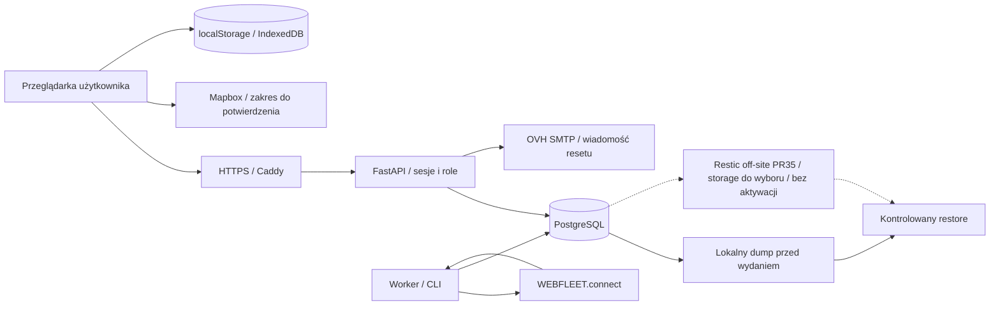

# SCRUM-112 — inwentarz danych i przepływów Fleet-Flow

Wersja 1, stan kodu 29.10.2026. Przygotowanie techniczne: Jakub Czaja.

Spis obejmuje 22 kategorie danych, 11 przepływów, 6 grup dostawców oraz 18 decyzji
potrzebnych do odbioru prywatności. Każda kategoria ma cel techniczny, pola,
magazyn/odbiorców, obecny cykl życia, zakres do uzasadnienia, właściciela
koordynacji i odnośniki do kodu. Pełny rejestr jest w
[inventory.v1.json](inventory.v1.json).

To wykonany spis techniczny dla SCRUM-112, do przeglądu. Status `BLOCKED` przy
polityce oznacza oczekującą decyzję w SCRUM-113. Nie oznacza, że takiej kategorii
nie ma w kodzie. Nie ustanawia podstawy przetwarzania, okresu retencji,
zgody na GPS ani wyniku screeningu DPIA. Osobą koordynującą jest Jakub Czaja;
tożsamość właściwego administratora i zatwierdzających ma potwierdzić SCRUM-113.
Akceptacje wypełnia właściwa osoba w kolejnym etapie SCRUM-113.

## Zakres i wersje źródeł

|Snapshot|Dokładny SHA|Co obejmuje|
|---|---|---|
|`main`|`4ce144e3e988106059acdbb6cd01ae9baa3beee4`|scalony kod; nie dowód aktywnej wersji serwera|
|`review_stack`|`ff8834917a9c05cc272dccede12689dc0f5c37a1`|otwarty stos PR; nie w main|
|`profile_pr31`|`0408144b943bc7ad5e9e3d47ae4f0b5640c94b7e`|osobny otwarty PR, poza stosem PR #51|

Gałąź dokumentacji jest oparta na aktualnym main i może być recenzowana
niezależnie od stosu kodu. W źródłach niżej użyto przypiętych SHA, także do
plików, których jeszcze nie ma na main. Stos PR #51 obejmuje m.in. PR #30 (przejazdy),
35 (backup), 36 (kontrolowany sync), 38 (indeksy SQL), 44 (proxy), 48 (role/docs),
49 (alerty), 50 (kierowcy API), 51 (kartoteka UI). PR #31 jest osobną gałęzią.
Daty zadań/sprintów i zielone CI nie dowodzą wdrożenia. Nie odczytywano VPS,
rzeczywistych rekordów, sekretów ani skrzynek; nie uruchamiano żywego API/SMTP.

## Wnioski istotne dla dalszej pracy

1. GPS i szczegóły floty są dostępne dla wszystkich zalogowanych ról w źródle.
   Obecny hash konta WEBFLEET nie tworzy relacji User→tenant ani ograniczenia
   dostępu admina IT. Macierz biznesowa i ADR organizacji: P03/P07.
2. `measurements` przechowuje ostatni stan, a nie pełną historię punktów.
   Agregaty dzienne, alerty, przypisania i backup mogą zachować starsze fakty.
   Próg świeżości 15 min i zakres zapytania 93 dni nie są retencją: P04.
3. Sesja 12 h i reset 20 min tracą ważność, ale rekord nie znika sam od zegara.
   Czyszczenie ma konkretne wyzwalacze opisane w D03–D05. Nie deklarować
   harmonogramu retencji, którego nie ma.
4. Ręczne przypisania są wiele:wiele. Brak daty legacy pozostaje nieznany.
   Przejazd w badanym modelu nie ma snapshotu kierowcy. Nie można automatycznie
   przypisać całej historii auta jednej osobie w DSAR: P05/P08.
5. Zdjęcia są lokalne w IndexedDB i nie są objęte pg_dump. Re-encoding bitmapy
   nie usuwa treści obrazu; pole `name` zachowuje do 120 znaków nazwy pliku.
   Wylogowanie odwołuje ObjectURL, ale nie wymazuje lokalnych zdjęć: P15.
6. Kopia przed wydaniem na main pozostaje lokalnym dumpem bez automatycznej
   retencji. Przygotowany off-site backup proponuje 7/4/6 kopii, ale wybór
   storage jest odłożony. Odrębnie ustalić kasowanie z DB i skutki restore: P13/P06.
7. POST search z kontaktem w body ogranicza ślad w URL, lecz GET drivers?q
   nadal istnieje. Start Uvicorn nie wyłącza access log; prywatność wszystkich
   sinków/tracebacków nie jest potwierdzona przez sanitację wybranego loggera: P14.
8. Kamera Mapbox jest dopasowywana do pozycji floty. Kod używa lokalnych
   markerów HTML; nie dowodzi to braku zewnętrznego przetwarzania SDK.
   Rzeczywiste żądania/telemetria/umowy wymagają P12.

## Mapa przepływów

Diagram grupuje istniejące i przygotowane ścieżki; status wdrożenia każdej
określają snapshoty i F01–F11 w JSON. Ruch, konfiguracja dostawcy i przywrócenie
na realnym środowisku wymagają osobnego dowodu operatora.

## Kategorie danych

Tabela streszcza rejestr. Pole `fields` w JSON zawiera dokładne kolumny,
klucze przeglądarki lub nazwy kategorii danych przejściowych — bez wartości.
Nazwy przyszłych pól nie są wymyślonym schematem. Minimalny zakres jest
wejściem do uzasadnienia przez właściciela; nie usuwa danych samym zapisem spisu.

|ID / kategoria|Stan kodu|Obecny magazyn i cykl życia|Decyzje|
|---|---|---|---|
|D01 Konta aplikacji|MAIN|PostgreSQL users; odpowiedź API i pamięć przeglądarki. Brak automatycznego usuwania kont ani zatwierdzonego okresu; active=false odcina dostęp, nie usuwa danych.|P01, P02, P03, P04, P05, P06|
|D02 Skróty haseł i hasło w żądaniu|MAIN|Hash w PostgreSQL; jawne hasło tylko podczas obsługi żądania; nie należy do payloadu API. Zmiana/reset nadpisuje hash; brak odrębnej retencji starych kopii backupu.|P02, P04, P05, P06, P13, P14|
|D03 Sesje i cookie|MAIN|Surowy token w HttpOnly cookie; SHA-256 tokenu w DB. Ważność domyślnie 12 h. Logout usuwa bieżącą sesję. Wygasłe rekordy są sprzątane przy udanym logowaniu; sam upływ czasu nie wykonuje DELETE.|P02, P03, P04, P06, P13, P15|
|D04 Liczniki prób logowania/resetu|MAIN|W DB SHA-256 prefiksu+IP lub loginu, początek okna i licznik; nie surowy IP w tej tabeli. Okno resetuje się przy następnym użyciu. Liczniki starsze niż 1 dzień są usuwane przy udanym loginie; brak niezależnego harmonogramu retencji.|P02, P04, P13, P14|
|D05 Reset hasła i wiadomość|MAIN|Hash w DB; treść wiadomości i adres przechodzą przez OVH SMTP/skrzynki; token trafia do przeglądarki z linku. Link ważny 20 min. Nowy reset zastępuje tokeny osoby; udane potwierdzenie usuwa tokeny i sesje. Wygaśnięcie samo nie usuwa rekordu ani kopii wiadomości.|P01, P02, P04, P06, P14|
|D06 Pojazdy i prywatne indeksy wyszukiwania|MAIN + REVIEW_STACK|PostgreSQL; UUID/nazwa/rejestracja w API i DOM. search_* to pochodne prywatne dodane w PR #38. Synchronizacja aktualizuje dane; brak auta w kompletnym odczycie ustawia active=false, nie usuwa rekordu.|P02, P03, P04, P05, P06, P07|
|D07 Ostatnia pozycja i stan pojazdu|MAIN|Jedna ostatnia próbka na pojazd w PostgreSQL; GeoJSON i szczegóły w pamięci/DOM przeglądarki. Nowy pomiar nadpisuje istniejący, stary nie cofa czasu. 15 min to próg świeżości, nie retencja. Brak próbek archiwalnych w tej tabeli; stare stany mogą istnieć w backupie/logach.|P01, P02, P03, P04, P07, P08, P10, P12, P13|
|D08 Ręczna kartoteka kierowcy|MAIN podstawowa; REVIEW_STACK rozszerzona|PostgreSQL; profil/kontakt w odpowiedzi API i pamięci widoku SCRUM-53. Dezaktywacja nie usuwa profilu. Zmiana nadpisuje pola i zwiększa version; nie tworzy pełnego audytu poprzednich wartości.|P02, P03, P04, P05, P06, P07, P09|
|D09 Ręczne kategorie prawa jazdy|REVIEW_STACK PR #50|PostgreSQL, odczyt w API i formularzu. Zmiana zastępuje zbiór kategorii; nie ma historii każdej poprzedniej zmiany kategorii.|P02, P03, P04, P05, P09|
|D10 Historia przypisań kierowca–pojazd|MAIN wskaźnik; REVIEW_STACK PR #50 historia|PostgreSQL; stronicowana lista w API/UI. Zamknięcie zachowuje wiersz z ended_at; dezaktywacja kończy bieżące relacje. Legacy started_at=null oznacza brak wiedzy. Ponowna aktywacja nie otwiera relacji.|P02, P03, P04, P05, P06, P08|
|D11 Fakty zapisanych przejazdów|REVIEW_STACK PR #30; importer SCRUM-24 PLANNED|PostgreSQL po przyroście SCRUM-30; odczyt API; geometria odpowiedzi null. Brak zatwierdzonej retencji. Limit odczytu 93 dni nie jest okresem przechowywania. Model nie zapisuje kierowcy/snapshotu osoby ani geometrii.|P02, P03, P04, P05, P06, P08, P10|
|D12 Cel/opis przejazdu i autor ostatniej edycji|REVIEW_STACK PR #30|PostgreSQL, API i edytor w RAM. Aktualizacja nadpisuje poprzedni cel/opis; wyczyszczenie daje null. Rekord autora/czasu nie jest pełnym audit trail SCRUM-87.|P02, P03, P04, P05, P06, P09, P16|
|D13 Reguły alertów|MAIN|PostgreSQL i API/UI reguł. Wyłączenie nie usuwa reguły ani wcześniejszych zdarzeń. Brak czasu autora/pełnego audytu zmian w tabeli.|P02, P03, P04, P06, P16|
|D14 Dzienny dystans i granice obserwacji|MAIN|PostgreSQL; wartości w alertach/odpowiedziach. Kolejne pomiary agregują dzień Europe/Warsaw; brak automatycznego kasowania dni. To nie pełna historia i nie dane anonimowe po zachowaniu vehicle_id.|P02, P03, P04, P05, P08|
|D15 Alerty i potwierdzenia odczytu|MAIN; UI w REVIEW_STACK PR #49|PostgreSQL, API, UI. Alert zachowuje snapshot dystansu/progu; reguła może się zmienić. Brak retencji alertów/receipts; odczyt nie usuwa zdarzenia.|P02, P03, P04, P05, P06, P09|
|D16 Stan synchronizacji i konto źródła|MAIN|PostgreSQL i bezpieczny payload aktualności. Aktualizacja wiersza per hash konta. Brak historii każdej próby i zatwierdzonej retencji; hash nadal wiąże cały zbiór źródła.|P03, P04, P07, P14|
|D17 Lokalne preferencje i identyfikatory|MAIN + REVIEW_STACK PR #51|localStorage w danym origin/przeglądarce, część per konto; brak synchronizacji SCRUM-91. Zapis do nadpisania/Reset/czyszczenia danych witryny; logout nie usuwa tych trwałych magazynów. Frazy/kontakt/formularz kierowcy nie są zapisywane w jego preferencjach.|P02, P04, P07, P15|
|D18 Lokalne zdjęcia i tło|MAIN|Bitmapa WebP w IndexedDB; ObjectURL/DOM w RAM; brak upload API. Re-encoding zmienia bajty obrazu; pole name zachowuje do 120 znaków oryginalnej nazwy. Zmiana/usunięcie obsługuje rekord; logout odwołuje ObjectURL, nie kasuje IndexedDB.|P02, P04, P05, P06, P15, P16|
|D19 Logi, request URL i dane transportowe|MAIN + REVIEW_STACK hardening|Procesy/standardowe logi kontenerów i journal; rzeczywisty sink/rotacja VPS nie zostały zbadane. CMD uvicorn nie wyłącza access log. Caddy nie deklaruje access log w pliku; to nie dowód braku logów u dostawcy. Brak spójnej polityki/centralnego monitora SCRUM-99.|P01, P02, P04, P11, P14|
|D20 Kopie PostgreSQL, manifest i recovery|MAIN kopia przed wydaniem; REVIEW_STACK PR #35 off-site|MAIN: /opt/fleet-flow/shared/backups/before-*.dump. PR #35: lokalny tymczasowy dump+zaszyfrowane repozytorium sieciowe, ostatni sukces w state. MAIN nie ma automatycznej retencji lokalnych dumpów. PR #35 proponuje 7 dziennych/4 tygodniowe/6 miesięcznych po weryfikacji nowej kopii; nie jest aktywowany ani zatwierdzony wybór storage. Backup nie usuwa danych po usunięciu rekordu w DB.|P01, P02, P04, P05, P06, P13, P14|
|D21 Sekrety konfiguracji, TLS i dostępu|MAIN + REVIEW_STACK PR #35|Prywatne runtime.env/.previous, pliki kluczy, środowisko procesów, systemowy/GitHub magazyn sekretów, wolumen Caddy. Wartości nie są częścią inwentarza. Runtime może mieć kopię previous; rotacja/revocation i retencja nie są wspólnym mechanizmem aplikacji. pg_dump nie obejmuje tych plików; odzyskanie wymaga niezależnego bezpiecznego procesu.|P01, P03, P04, P11, P13, P18|
|D22 Planowane dokumenty, eksporty i audit|PLANNED SCRUM-57/58/59/60/87/109/110/111|Brak działającego storage uploadów, DSAR i append-only audit w badanych snapshotach; nie utożsamiać z lokalnym IndexedDB. Brak istniejącego wykonawcy polityki; okresy i wyjątki wymagają SCRUM-113 przed SCRUM-109–111. Nie aktywowano usuwania.|P02, P03, P04, P05, P06, P09, P16, P17|

W każdym wierszu: wersja 1, koordynacja Jakub Czaja, właściciel decyzji
administrator/uprawniony zatwierdzający do wskazania w SCRUM-113, status
polityki `BLOCKED`. Nie użyto `APPROVED` dla niezatwierdzonego przetwarzania.
Zatwierdzone wcześniej decyzje produktu (wiele:wiele i początkowy postój 5 min)
są odrębnymi `PROD-01/02`; nie zatwierdzają prywatności ani retencji.

## Dostawcy i granice zaufania

|ID / usługa|Zaobserwowany kierunek|Dane i niewiadome|
|---|---|---|
|V01 WEBFLEET.connect|F02: https://csv.webfleet.com/extern|Poświadczenia backendu i zapytania źródła; wejściowo pola allowlisty pojazdów/pomiarów. Do potwierdzenia: Podmiot umowy, rola prawna, kraj/region, retencja dostawcy, podwykonawcy i uprawnienia realnego konta.|
|V02 Mapbox|F04: api.mapbox.com; events.mapbox.com; *.tiles.mapbox.com dopuszczone w CSP review|Mapa/style, token publiczny i obszar kamery wyznaczany z floty; telemetryka i rzeczywiste żądania niezweryfikowane. Do potwierdzenia: Konfiguracja SDK/token, przepływy sieciowe, zakres/wyłączenie telemetrii, umowy, region i odbiorcy.|
|V03 OVH SMTP|F06: smtp.mail.ovh.net / ssl0.ovh.net, TLS 465|Konto SMTP, adres nadawcy/odbiorcy i wiadomość resetu; osobno PR #31 powiadomienie o haśle. Do potwierdzenia: Umowa/rola, retencja skrzynek i logów, faktyczna dostawa oraz dostęp do poczty.|
|V04 VPS, DNS i HTTPS|F01: Konfiguracja Compose/Caddy; dostawca/umowa środowiska do potwierdzenia|Ruch HTTPS, baza, logi/backupy i prywatny runtime; osobne konto operatora. Do potwierdzenia: Podmiot umowy, region, kopie dostawcy, logdriver, uprawnienia operatorów i wdrożony SHA.|
|V05 Off-site storage|F09: nie wybrano|Po aktywacji: zaszyfrowany pełny dump+manifest i metadane repozytorium restic. Do potwierdzenia: Wyboru nie dokonano; niezależność, koszt, role, klucz i region pozostają BLOCKED.|
|V06 GitHub / CI / registry oraz Atlassian|F10: Repozytorium projektu i Jira SCRUM; registry do wyboru|Kod, dane zespołu i zadania, syntetyczne testy/artefakty; prywatne sekrety wyłącznie w odpowiednim magazynie. Do potwierdzenia: Uprawnienia usług, retencja logów/zadań, region/umowy i przyszły registry; brak danych klientów w dowodach.|

Nie rozstrzygnięto ról prawnych dostawców, krajów/regionów, transferów ani treści
umów na podstawie domeny technicznej. Rejestr dostawców ma wersję 1 i `BLOCKED`,
koordynuje Jakub Czaja, technicznie weryfikuje Dawid Hnat. Dostęp operatorów,
kopie dostawców i realne ustawienia usług są nieznane bez odrębnego odbioru.

## Rejestr decyzji do SCRUM-113

Każda decyzja ma wersję 1, status `BLOCKED`, datę utworzenia 29.10.2026,
koordynatora Jakuba Czaję oraz pusty `approved_by/approved_at` oraz `decision_due_on`. Nie wpisano
fikcyjnych terminów ani nazwiska administratora/DPO. Termin i właściwą osobę
uzupełnia koordynator na podstawie rzeczywistego ustalenia.

|ID / decyzja|Właściciel rozstrzygnięcia|Wymagany wynik / zadania|
|---|---|---|
|P01 Wskazać administratora, dostawców i uprawnionych zatwierdzających|Administrator danych — tożsamość do potwierdzenia; koordynuje Jakub Czaja|Nazwa podmiotu/rola każdej usługi, osoba zatwierdzająca, umowy, lokalizacje, podwykonawcy i zakres uprawnień. Nie wywodzić ich z hosta lub nazwy produktu. SCRUM-113|
|P02 Zatwierdzić cel, dopuszczalne użycie i podstawę dla każdej kategorii|Administrator danych z właściwą konsultacją DPO/prawną|Wiersze D01–D22; uzasadnione minimalne pola i zakazane dodatkowe użycia. Inwentarz techniczny nie wybiera podstawy ani nie ustanawia zgody. SCRUM-113|
|P03 Zatwierdzić macierz odczytu GPS i danych osoby|Administrator danych i PO; technicznie Dawid Hnat|Role biznesowe, admin IT, zakres pojazdów/historii/dokumentów/eksportu oraz odcięcie sesji; mapowanie do obecnych admin/editor/viewer. SCRUM-113 / SCRUM-48|
|P04 Zatwierdzić retencję, zdarzenia początku i wyjątki per kategoria|Administrator danych; technicznie Dawid Hnat|Osobno baza, kopie, pliki, logi i przeglądarka; okres/zdarzenie wygaśnięcia, blokada, wyjątki i dowód zatwierdzenia. Brak liczby nie uruchamia usuwania. SCRUM-113 → SCRUM-109|
|P05 Ustalić uprawniony zakres eksportu osoby|Administrator danych; koordynuje Jakub Czaja|Weryfikacja zgłaszającego, autoryzujący, okres/identyfikatory, niejednoznaczne przypisania i wyłączenie danych innych osób; bez sekretów. SCRUM-113 → SCRUM-110|
|P06 Ustalić usuwanie, anonimizację, wyjątki i recovery|Administrator danych; wykonuje operator po zatwierdzeniu|Rozróżnić archiwizację/wyczyszczenie pola/usunięcie, wyjątki i pliki; trwały minimalny ślad oraz sposób ponownego zastosowania po restore. SCRUM-113 → SCRUM-109/111/84|
|P07 Rozstrzygnąć ADR jednej organizacji lub modelu tenantów|PO i administrator danych; projektuje Dawid Hnat|Hash konta WEBFLEET nie przypisuje User do organizacji. Wymagania izolacji, operatorzy i użycie wspólnej przeglądarki przed rozszerzeniem. SCRUM-113 / SCRUM-48|
|P08 Ustalić prywatne użycie pojazdu i zakres GPS|Administrator danych i kierownik floty przez PO|Godziny/cel/odbiorcy prywatnych przejazdów, brakujące dane i niejednoznaczność wielu kierowców. Bez automatycznego przypisania osoby lub uniwersalnej zgody. SCRUM-113|
|P09 Przygotować informowanie osób i instrukcje wolnego tekstu|Administrator danych; koordynuje Jakub Czaja|Osoby/kategorie/odbiorcy, aktualizacja informacji i instrukcja ograniczenia treści nazw, adnotacji, plików i kontaktu do zatwierdzonego celu. SCRUM-113|
|P10 Przeprowadzić i udokumentować screening DPIA|Właściwy DPO/prawnik i administrator danych — do wskazania w SCRUM-113|Zakres GPS, historii, skali, dostępu i zastosowań; uzasadniony wynik screeningu i dalsze działania. Ten dokument nie rozstrzyga wyniku. SCRUM-113|
|P11 Ustalić procedurę incydentu i kontakty odpowiedzialne|Administrator danych i operator; koordynuje Jakub Czaja|Kontakt i odpowiedzialność, zabezpieczenie dowodów, zakres logów, ograniczenie dostępu, decyzje i właściwe dalsze powiadomienia. Nie wysyłano zgłoszeń. SCRUM-113 / SCRUM-99|
|P12 Zweryfikować zakres zewnętrznej mapy i SDK|Operator Dawid Hnat; zatwierdza administrator danych/PO|Kamera dopasowuje się do pozycji floty. Ustalić rzeczywiste żądania i ewentualną telemetrię wersji SDK, ustawienia tokenu, umowy i transfery. Bez założenia, że cały GeoJSON jest uploadowany lub że SDK nic nie wysyła. SCRUM-113|
|P13 Wybrać i odebrać niezależny storage/recovery|Dawid Hnat i PO; administrator danych zatwierdza zakres|Niezależność konta/dostawcy, koszt, klucz poza VPS, retencja, RPO/RTO, restore poza VPS i dowody. Użytkownik odłożył wybór storage. SCRUM-84 / SCRUM-113|
|P14 Ustalić inwentarz sinków logów, dostęp i rotację|Operator Dawid Hnat; zakres zatwierdza administrator danych|ASGI/proxy/journal/logdriver/SMTP/provider/Mapbox; query z nazwą/kontaktem, traceback, bezpieczne kody i brak sekretów. Nie kopiować rzeczywistych logów do publicznego PR. SCRUM-113 / SCRUM-99|
|P15 Ustalić lifecycle lokalnego urządzenia|PO i administrator danych; implementacja frontend|Klucze i zakres konta, wspólne tło, zachowane nazwy plików i bitmapy, instrukcja usunięcia danych witryny; logout nie jest wymazaniem urządzenia. SCRUM-113 / SCRUM-91|
|P16 Uzgodnić minimalne pola przyszłych plików i audytu|Administrator danych i PO; projektuje Dawid Hnat|Dokumenty auta kontra dokumenty osoby, pola metadanych, aktualny owner/retencja, storage/weryfikacja, minimalny audit bez treści GPS/PII. SCRUM-113 / SCRUM-57/87|
|P17 Uzgodnić bezpieczne wydanie i wygaśnięcie pliku eksportu|Administrator danych; implementacja backend/QA|Osoba otrzymująca, autoryzacja pobrania, limity, manifest braków, czas życia, anulowanie oraz usunięcie wszystkich kopii; DSAR odrębny od CSV biznesowego. SCRUM-113 / SCRUM-110/50|
|P18 Potwierdzić dostęp i retencję narzędzi wytwarzania/wdrożenia|Owner repozytorium i operator Dawid Hnat; PO|GitHub/Atlassian/runner/registry: dane zespołu, logi, artefakty, sekrety, uprawnienia. 7 dni dotyczy wybranych artefaktów workflow, nie wszystkich logów i danych usług. SCRUM-113 / SCRUM-95/100|

Po decyzji zapisać identyfikator, zakres kategorii/pól, konkretną osobę i jej
umocowanie, wersję polityki, datę/odnośnik do zatwierdzenia oraz `APPROVED`
albo uzasadnione `BLOCKED`. Wrażliwe dokumenty i rzeczywiste dane pozostają
w prywatnym, uprawnionym miejscu; do publicznego repo trafia wyłącznie
bezpieczny identyfikator decyzji. Produktowe zatwierdzenia z czatu nie
wypełniają automatycznie pola prawnej/politycznej akceptacji.

## Przekazanie do implementacji

|Zadanie|Dane wejściowe ze spisu|Warunek rozpoczęcia/odbioru|
|---|---|---|
|SCRUM-113/94|D01–D22, V01–V06, P01–P18|Właściwy administrator, zatwierdzony cel/zakres, dostawcy, screening DPIA, ADR i brakujące decyzje|
|SCRUM-109|D01–D22 oraz P04/P06/P13/P15|Okresy/zdarzenia, wyjątki i restore; żaden domyślny okres nie uruchamia automatycznego usuwania|
|SCRUM-110|D01/D06–D15/D18/D20/D22, P03/P05/P07/P17|Tożsamość, zakres osoby i innych osób, manifest braków, odbiorca oraz wygasanie pliku|
|SCRUM-111|P04/P06/P13 i rejestr wykonania SCRUM-109|Zatwierdzony podgląd, wyjątki, ślad, przerwanie/retry i ponowne zastosowanie po restore|
|SCRUM-48|P03/P07 i rzeczywiste role|Obecne admin/editor/viewer nie są same w sobie zatwierdzoną macierzą biznesową|
|SCRUM-87|D12/D19/D22 oraz P04/P06/P16|Minimalne pola i okres śladu ustalone przed budową append-only audytu|
|SCRUM-84/99/100|D19–D21 oraz P13/P14/P18|Operator zatwierdza storage, dostęp, koszt i dowody; bez aktywacji przez samą dokumentację|

Dane w przeglądarce, poczcie, lokalnych dumpach i kopiach dostawców wymagają
odrębnej obsługi; implementacja DELETE w PostgreSQL nie pokrywa tych magazynów.
Współdzielone auto i nieznane daty nie uprawniają do eksportu danych innych osób.
Nie utożsamiać deaktywacji, flagi odczytu, nadpisania pola i fizycznego usunięcia.

## Odbiór techniczny spisu

Sprawdzenie dokumentacji obejmuje: poprawny JSON, unikalne ID, kompletność
powiązań kategorii/flow/decisions/evidence, obecność ścieżek w dokładnych
obiektach Git oraz pokrycie wszystkich kolumn ORM dla main i stosu PR51.
Odczyt źródeł wykonano statycznie; nie tworzono dumpu ani rekordów użytkowników.
Brak zmiany kodu aplikacji nie wymaga ponawiania testów zachowania UI.
Wymagane CI i review dokumentacji są osobnym dowodem na SHA PR tego zadania.

Reviewer techniczny: Dawid Hnat. Odbiorca produktowy: Jakub Czaja.
SCRUM-112 trafia do przeglądu z kompletnym spisem; zatwierdzanie polityk
pozostaje w SCRUM-113. Nie oznaczać całości SCRUM-94/109–111 jako Done po tym PR.
Aktualizacja spisu jest wymagana po zmianie modelu, API, dostawcy, magazynu,
logowania, eksportu lub reguły dostępu; nowa wersja zachowuje historię decyzji.

## Źródła w kodzie

- `core` — [review_stack: backend/app/core/models.py](https://github.com/DawidHnat/Projekt_Zespolowy/blob/ff8834917a9c05cc272dccede12689dc0f5c37a1/backend/app/core/models.py)
- `auth` — [review_stack: backend/app/modules/auth/models.py](https://github.com/DawidHnat/Projekt_Zespolowy/blob/ff8834917a9c05cc272dccede12689dc0f5c37a1/backend/app/modules/auth/models.py)
- `auth-service` — [review_stack: backend/app/modules/auth/service.py](https://github.com/DawidHnat/Projekt_Zespolowy/blob/ff8834917a9c05cc272dccede12689dc0f5c37a1/backend/app/modules/auth/service.py)
- `auth-router` — [review_stack: backend/app/modules/auth/router.py](https://github.com/DawidHnat/Projekt_Zespolowy/blob/ff8834917a9c05cc272dccede12689dc0f5c37a1/backend/app/modules/auth/router.py)
- `reset` — [review_stack: backend/app/modules/auth/reset.py](https://github.com/DawidHnat/Projekt_Zespolowy/blob/ff8834917a9c05cc272dccede12689dc0f5c37a1/backend/app/modules/auth/reset.py)
- `settings` — [review_stack: backend/app/core/settings.py](https://github.com/DawidHnat/Projekt_Zespolowy/blob/ff8834917a9c05cc272dccede12689dc0f5c37a1/backend/app/core/settings.py)
- `config` — [review_stack: backend/app/core/config.py](https://github.com/DawidHnat/Projekt_Zespolowy/blob/ff8834917a9c05cc272dccede12689dc0f5c37a1/backend/app/core/config.py)
- `drivers` — [review_stack: backend/app/modules/drivers/models.py](https://github.com/DawidHnat/Projekt_Zespolowy/blob/ff8834917a9c05cc272dccede12689dc0f5c37a1/backend/app/modules/drivers/models.py)
- `drivers-api` — [review_stack: backend/app/modules/drivers/router.py](https://github.com/DawidHnat/Projekt_Zespolowy/blob/ff8834917a9c05cc272dccede12689dc0f5c37a1/backend/app/modules/drivers/router.py)
- `drivers-service` — [review_stack: backend/app/modules/drivers/service.py](https://github.com/DawidHnat/Projekt_Zespolowy/blob/ff8834917a9c05cc272dccede12689dc0f5c37a1/backend/app/modules/drivers/service.py)
- `fleet-api` — [review_stack: backend/app/modules/fleet/router.py](https://github.com/DawidHnat/Projekt_Zespolowy/blob/ff8834917a9c05cc272dccede12689dc0f5c37a1/backend/app/modules/fleet/router.py)
- `fleet-service` — [review_stack: backend/app/modules/fleet/service.py](https://github.com/DawidHnat/Projekt_Zespolowy/blob/ff8834917a9c05cc272dccede12689dc0f5c37a1/backend/app/modules/fleet/service.py)
- `sync` — [review_stack: backend/app/modules/fleet/sync.py](https://github.com/DawidHnat/Projekt_Zespolowy/blob/ff8834917a9c05cc272dccede12689dc0f5c37a1/backend/app/modules/fleet/sync.py)
- `adapter` — [review_stack: backend/app/integrations/webfleet/client.py](https://github.com/DawidHnat/Projekt_Zespolowy/blob/ff8834917a9c05cc272dccede12689dc0f5c37a1/backend/app/integrations/webfleet/client.py)
- `snapshot` — [review_stack: backend/app/integrations/webfleet/models.py](https://github.com/DawidHnat/Projekt_Zespolowy/blob/ff8834917a9c05cc272dccede12689dc0f5c37a1/backend/app/integrations/webfleet/models.py)
- `trips` — [review_stack: backend/app/modules/trips/models.py](https://github.com/DawidHnat/Projekt_Zespolowy/blob/ff8834917a9c05cc272dccede12689dc0f5c37a1/backend/app/modules/trips/models.py)
- `trips-api` — [review_stack: backend/app/modules/trips/router.py](https://github.com/DawidHnat/Projekt_Zespolowy/blob/ff8834917a9c05cc272dccede12689dc0f5c37a1/backend/app/modules/trips/router.py)
- `analytics` — [review_stack: backend/app/modules/analytics/models.py](https://github.com/DawidHnat/Projekt_Zespolowy/blob/ff8834917a9c05cc272dccede12689dc0f5c37a1/backend/app/modules/analytics/models.py)
- `analytics-api` — [review_stack: backend/app/modules/analytics/router.py](https://github.com/DawidHnat/Projekt_Zespolowy/blob/ff8834917a9c05cc272dccede12689dc0f5c37a1/backend/app/modules/analytics/router.py)
- `analytics-service` — [review_stack: backend/app/modules/analytics/service.py](https://github.com/DawidHnat/Projekt_Zespolowy/blob/ff8834917a9c05cc272dccede12689dc0f5c37a1/backend/app/modules/analytics/service.py)
- `mail` — [review_stack: backend/app/integrations/mail/client.py](https://github.com/DawidHnat/Projekt_Zespolowy/blob/ff8834917a9c05cc272dccede12689dc0f5c37a1/backend/app/integrations/mail/client.py)
- `photo-store` — [review_stack: frontend/src/features/fleet/model/vehicle-photo-store.ts](https://github.com/DawidHnat/Projekt_Zespolowy/blob/ff8834917a9c05cc272dccede12689dc0f5c37a1/frontend/src/features/fleet/model/vehicle-photo-store.ts)
- `photo` — [review_stack: frontend/src/shared/media/local-image.ts](https://github.com/DawidHnat/Projekt_Zespolowy/blob/ff8834917a9c05cc272dccede12689dc0f5c37a1/frontend/src/shared/media/local-image.ts)
- `background` — [review_stack: frontend/src/features/dashboard/model/background-image.ts](https://github.com/DawidHnat/Projekt_Zespolowy/blob/ff8834917a9c05cc272dccede12689dc0f5c37a1/frontend/src/features/dashboard/model/background-image.ts)
- `preferences` — [review_stack: frontend/src/app/preferences.ts](https://github.com/DawidHnat/Projekt_Zespolowy/blob/ff8834917a9c05cc272dccede12689dc0f5c37a1/frontend/src/app/preferences.ts)
- `preference-model` — [review_stack: frontend/src/app/preference-model.ts](https://github.com/DawidHnat/Projekt_Zespolowy/blob/ff8834917a9c05cc272dccede12689dc0f5c37a1/frontend/src/app/preference-model.ts)
- `vehicle-preferences` — [review_stack: frontend/src/features/fleet/model/VehiclePreferences.tsx](https://github.com/DawidHnat/Projekt_Zespolowy/blob/ff8834917a9c05cc272dccede12689dc0f5c37a1/frontend/src/features/fleet/model/VehiclePreferences.tsx)
- `fleet-browser` — [review_stack: frontend/src/features/fleet/model/FleetProvider.tsx](https://github.com/DawidHnat/Projekt_Zespolowy/blob/ff8834917a9c05cc272dccede12689dc0f5c37a1/frontend/src/features/fleet/model/FleetProvider.tsx)
- `driver-preferences` — [review_stack: frontend/src/features/drivers/model/preferences.ts](https://github.com/DawidHnat/Projekt_Zespolowy/blob/ff8834917a9c05cc272dccede12689dc0f5c37a1/frontend/src/features/drivers/model/preferences.ts)
- `driver-browser` — [review_stack: frontend/src/features/drivers/model/DriverContext.tsx](https://github.com/DawidHnat/Projekt_Zespolowy/blob/ff8834917a9c05cc272dccede12689dc0f5c37a1/frontend/src/features/drivers/model/DriverContext.tsx)
- `map` — [review_stack: frontend/src/features/fleet/components/VehicleMap.tsx](https://github.com/DawidHnat/Projekt_Zespolowy/blob/ff8834917a9c05cc272dccede12689dc0f5c37a1/frontend/src/features/fleet/components/VehicleMap.tsx)
- `markers` — [review_stack: frontend/src/features/fleet/components/vehicle-markers.ts](https://github.com/DawidHnat/Projekt_Zespolowy/blob/ff8834917a9c05cc272dccede12689dc0f5c37a1/frontend/src/features/fleet/components/vehicle-markers.ts)
- `http-client` — [review_stack: frontend/src/shared/api/client.ts](https://github.com/DawidHnat/Projekt_Zespolowy/blob/ff8834917a9c05cc272dccede12689dc0f5c37a1/frontend/src/shared/api/client.ts)
- `caddy` — [review_stack: infra/deploy/Caddyfile](https://github.com/DawidHnat/Projekt_Zespolowy/blob/ff8834917a9c05cc272dccede12689dc0f5c37a1/infra/deploy/Caddyfile)
- `compose` — [review_stack: infra/deploy/compose.yml](https://github.com/DawidHnat/Projekt_Zespolowy/blob/ff8834917a9c05cc272dccede12689dc0f5c37a1/infra/deploy/compose.yml)
- `docker` — [review_stack: infra/deploy/backend.Dockerfile](https://github.com/DawidHnat/Projekt_Zespolowy/blob/ff8834917a9c05cc272dccede12689dc0f5c37a1/infra/deploy/backend.Dockerfile)
- `backup` — [review_stack: infra/backup/backup.py](https://github.com/DawidHnat/Projekt_Zespolowy/blob/ff8834917a9c05cc272dccede12689dc0f5c37a1/infra/backup/backup.py)
- `backup-guide` — [review_stack: infra/backup/README.md](https://github.com/DawidHnat/Projekt_Zespolowy/blob/ff8834917a9c05cc272dccede12689dc0f5c37a1/infra/backup/README.md)
- `deploy` — [review_stack: infra/deploy/deploy.sh](https://github.com/DawidHnat/Projekt_Zespolowy/blob/ff8834917a9c05cc272dccede12689dc0f5c37a1/infra/deploy/deploy.sh)
- `ci` — [review_stack: .github/workflows/ci.yml](https://github.com/DawidHnat/Projekt_Zespolowy/blob/ff8834917a9c05cc272dccede12689dc0f5c37a1/.github/workflows/ci.yml)
- `errors` — [review_stack: backend/app/core/errors.py](https://github.com/DawidHnat/Projekt_Zespolowy/blob/ff8834917a9c05cc272dccede12689dc0f5c37a1/backend/app/core/errors.py)
- `main` — [review_stack: backend/app/main.py](https://github.com/DawidHnat/Projekt_Zespolowy/blob/ff8834917a9c05cc272dccede12689dc0f5c37a1/backend/app/main.py)
- `profile-pr31` — [profile_pr31: backend/app/modules/auth/profile.py](https://github.com/DawidHnat/Projekt_Zespolowy/blob/0408144b943bc7ad5e9e3d47ae4f0b5640c94b7e/backend/app/modules/auth/profile.py)
- `readme` — [main: README.md](https://github.com/DawidHnat/Projekt_Zespolowy/blob/4ce144e3e988106059acdbb6cd01ae9baa3beee4/README.md)
- `main-auth` — [main: backend/app/modules/auth/models.py](https://github.com/DawidHnat/Projekt_Zespolowy/blob/4ce144e3e988106059acdbb6cd01ae9baa3beee4/backend/app/modules/auth/models.py)
- `main-core` — [main: backend/app/core/models.py](https://github.com/DawidHnat/Projekt_Zespolowy/blob/4ce144e3e988106059acdbb6cd01ae9baa3beee4/backend/app/core/models.py)
- `main-analytics` — [main: backend/app/modules/analytics/models.py](https://github.com/DawidHnat/Projekt_Zespolowy/blob/4ce144e3e988106059acdbb6cd01ae9baa3beee4/backend/app/modules/analytics/models.py)
- `main-caddy` — [main: infra/deploy/Caddyfile](https://github.com/DawidHnat/Projekt_Zespolowy/blob/4ce144e3e988106059acdbb6cd01ae9baa3beee4/infra/deploy/Caddyfile)
- `main-deploy` — [main: infra/deploy/deploy.sh](https://github.com/DawidHnat/Projekt_Zespolowy/blob/4ce144e3e988106059acdbb6cd01ae9baa3beee4/infra/deploy/deploy.sh)
